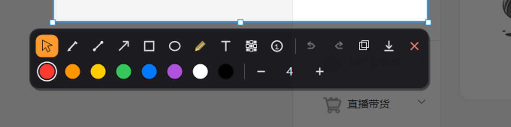
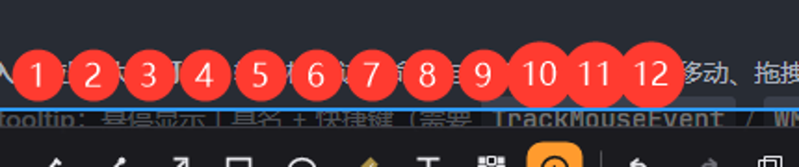
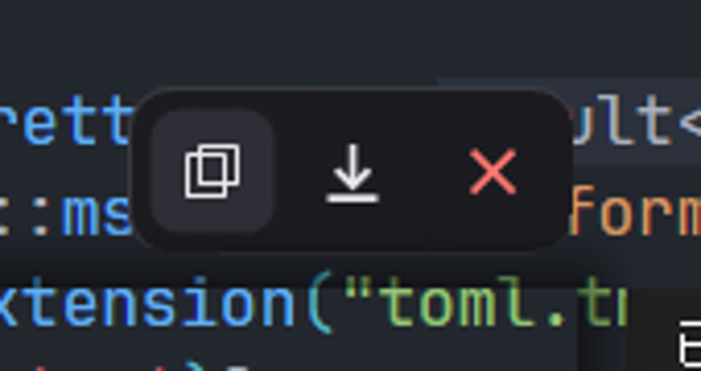

# window-cap

Windows 截图与标注工具，使用 Rust + [`windows-rs`](https://github.com/microsoft/windows-rs) 实现，交互参考 Flameshot。

仓库：<https://github.com/HaroldLoui/windows-cap>

当前版本：**0.10.0-beta.4**（Beta）。支持 Windows 10/11，单显示器 100% DPI 已验证；4K/多屏/混合 DPI 仍在兼容性测试中。



## 功能

- **截图**：全局热键唤起遮罩，拖拽选区，支持移动/缩放选区
- **标注**：画笔、直线、箭头（实心三角）、矩形、椭圆、高亮、文字、马赛克、序号（≥10 自动放大）
- **文字**：透明输入框、长文本自动换行、拖动移动、右下角缩放
- **工具栏**：纯图标两行布局、外部优先放置、hover/tooltip、撤销/重做/复制/保存/关闭
- **贴图 Pin**：截图置顶悬浮，阴影、拖动、Ctrl+滚轮缩放（显示百分比）、复制/保存/关闭
- **输出**：复制到剪贴板（CF_DIB）、PNG 原子写入
- **常驻**：托盘菜单、全局热键、单实例、配置、开机自启、延迟截图、上次选区
- **打包**：一键生成便携 zip

<p>
  
  
</p>

## 快速开始

### 从源码构建

需要 Rust 1.85+（edition 2024）：

```powershell
cargo build --release
target\release\window-cap.exe
```

### 便携包

```powershell
powershell -NoProfile -File scripts\package.ps1
```

产物位于 `dist/window-cap-<version>-portable.zip`。

## 使用

启动后常驻托盘，默认热键：

| 操作 | 快捷键 |
|---|---|
| 截图 | `Ctrl+Alt+A` |
| 退出常驻 | `Ctrl+Alt+Q` |

截图流程：

1. 热键唤起遮罩，拖拽选区；
2. 在工具栏选工具标注，`Ctrl+Z` 撤销；
3. `Ctrl+C` 复制、`Ctrl+S` 保存、`Esc` 取消；
4. 点击工具栏“贴图”按钮把当前结果固定到屏幕最上层。

贴图窗口：左键拖动、`Ctrl+滚轮`缩放、`Enter`/`Ctrl+S` 保存、`Ctrl+C` 复制、`Esc`/双击关闭，外侧操作条也可点击。

### 命令行

```powershell
window-cap.exe                 # 常驻
window-cap.exe --once          # 立即截图一次后退出
window-cap.exe --capture --region 100,100,400,300 --output shot.png
window-cap.exe --capture --last --output shot.png
window-cap.exe --selftest      # 环境/采集/剪贴板/落盘自检
```

完整参数：`window-cap.exe --help`。

## 配置

路径：`%APPDATA%\window-cap\config.toml`（首次运行自动生成）。

```toml
[hotkey]
capture = "Ctrl+Alt+A"
quit = "Ctrl+Alt+Q"

[output]
save_dir = "Pictures/Screenshots"
copy_to_clipboard = true

[capture]
delay_ms = 0
```

修改后可在托盘菜单选择“重载配置”。

## 文档

- [开发文档](docs/开发文档.md)：模块职责、功能 → 代码索引、关键流程
- [实施进度](docs/progress.md)
- [待办清单](docs/待办.md)
- [Beta 回归报告](docs/Beta回归.md)
- [兼容性](docs/兼容性.md)

## 开发

```powershell
cargo fmt
cargo clippy --all-targets -- -D warnings
cargo test
cargo run -- --once
```

代码约定见[开发文档](docs/开发文档.md)。核心目录：

```
src/app         常驻、托盘、热键、配置、单实例
src/capture     屏幕采集、Frame/Rect
src/annotate    标注模型与 GDI+ 渲染
src/ui          遮罩、选区、工具栏、文字、贴图
src/output      PNG / 剪贴板
```

## 状态与路线

- ✅ 基础截图、标注、工具栏、文字、贴图、常驻
- ⏳ 4K/多屏/混合 DPI/RDP/HDR 兼容性（无硬件，暂缓）
- ⏳ 截长图（方案评估完成）
- ⏳ MSI 安装包 / 自动更新（等 GitHub 发布后）

## 贡献

欢迎 Issue / PR。提交前请运行 `cargo fmt`、`cargo clippy --all-targets -- -D warnings`、`cargo test`，并保持注释风格：文件/函数一句话说明职责，长函数用简短步骤注释。

## 许可证

MIT，见 [LICENSE](LICENSE)。
